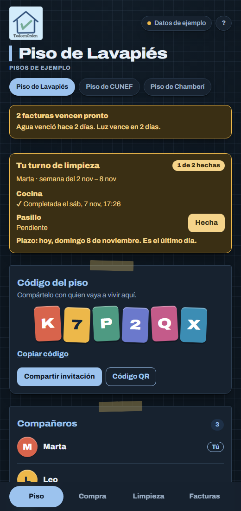
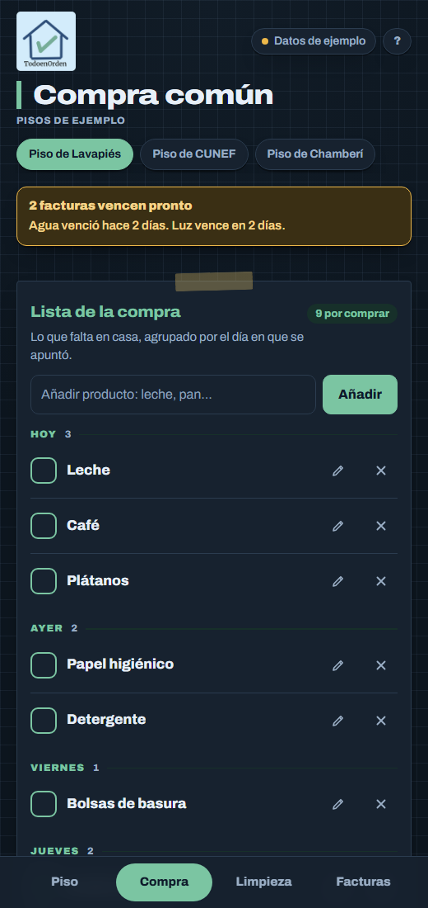
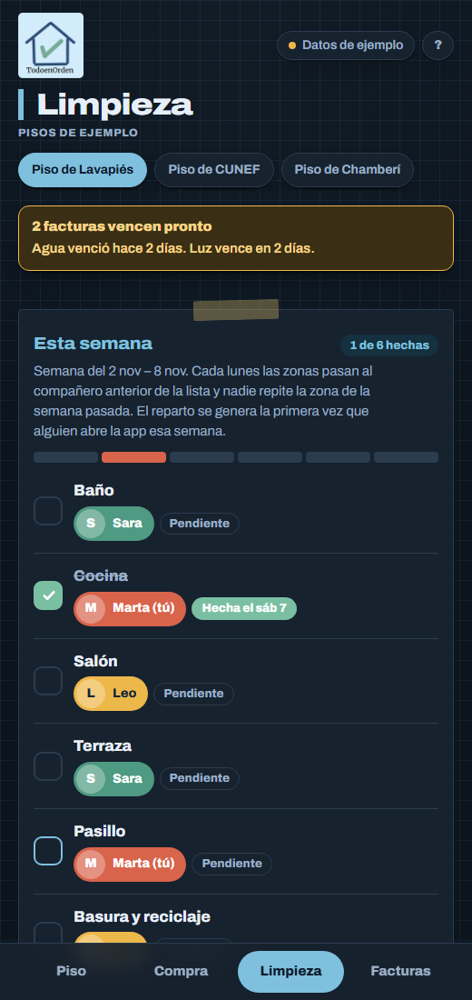
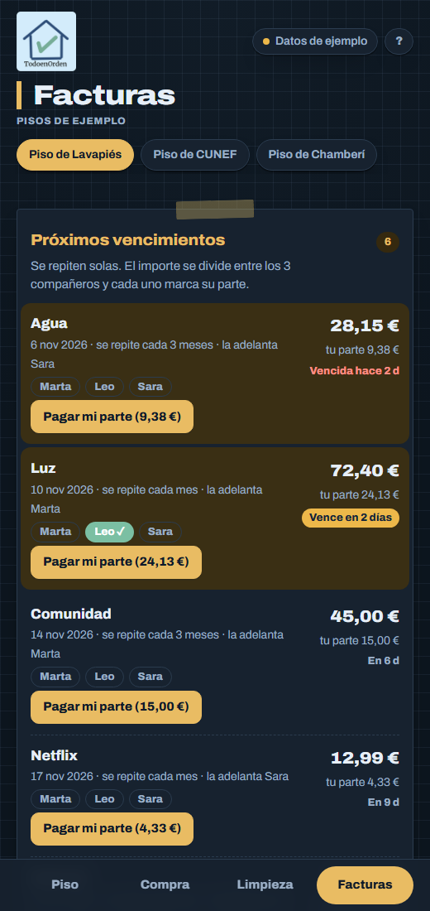

# 🏠 TodoenOrden

**El piso compartido, sin líos.**
Compra, limpieza y facturas en un solo sitio.

### 👉 [Abrir la app](https://manucem.github.io/TodoEnOrden/index.html)
### 🧪 [Probar el modo demo](https://manucem.github.io/TodoEnOrden/index.html?demo)

---

## 📸 Así se ve

<table>
  <tr>
    <td align="center" width="50%"> <b>🏠 Piso</b></td>
    <td align="center" width="50%"> <b>🛒 Compra</b></td>
  </tr>
  <tr>
    <td align="center" width="50%"> <b>🧹 Limpieza</b></td>
    <td align="center" width="50%"> <b>💶 Facturas</b></td>
  </tr>
</table>

Capturas del modo demo, con datos de ejemplo.

---

## ✨ Qué hace

- 🚪 **Alta:** crea un piso (código de 6 caracteres) o únete con el código o un enlace.
- 🏠 **Piso:** tu turno de limpieza, código, invitación por enlace o QR, compañeros con foto y ajustes del piso.
- 🛒 **Compra:** lista compartida por días, sin duplicados.
- 🧹 **Limpieza:** zonas y turnos semanales que rotan solos. Cada persona marca solo lo suyo. Histórico de cumplimiento con fotos.
- 💶 **Facturas:** importe repartido entre todos, cada uno marca su parte y la app avisa de los vencimientos.
- 👤 **Mi perfil:** tu cuenta, tu foto y nombre, todos tus pisos y eliminar la cuenta.

---

## 🔐 Cuentas

- **Sin registro.** Al abrir la app se crea un usuario anónimo. Sin correo ni contraseña.
- **Google, cuando quieras.** El botón de la cabecera lo enlaza a tu usuario y no pierdes tu piso. Si esa cuenta de Google ya existía, la app entra con ella.
- **Nombre y foto automáticos** desde Google. Puedes cambiarlos en *Mi perfil* sin tocar tu cuenta de Google.
- **Cerrar sesión** vuelve a un usuario anónimo nuevo.
- **Eliminar mi cuenta** te saca de tus pisos. Si eras admin y hay más gente, el admin pasa a alguien al azar. Si estabas solo, el piso se elimina.

### 👑 Admin del piso

El admin es **quien creó el piso**.

- **Salir del piso:** cualquiera. La app avisa si hay deudas.
- **Salir siendo admin:** primero hay que elegir a otra persona como admin.
- **Salir siendo la última persona:** el piso se elimina. La app lo avisa antes.
- **Eliminar el piso para todos:** solo el admin, escribiendo el nombre del piso para confirmar.

### 🔗 Invitar

En *Piso*: **Compartir invitación** y **Código QR**. El enlace es `…/index.html?codigo=ABC123`. Al abrirlo, la app pregunta *«¿Quieres unirte a este piso?»* y nunca entra sola.

---

## 🛡️ Seguridad

- **Datos protegidos con RLS.** La base de datos solo deja ver y cambiar lo del propio piso. La clave pública del código (`sb_publishable_…`) está pensada para estar en el navegador.
- **Funciones con permisos.** Salir, eliminar piso y eliminar cuenta son funciones de la base de datos que comprueban quién las llama.
- **Admin a prueba de manipulación.** El admin solo cambia por esas funciones, no editando la tabla.
- **Política de contenido (CSP).** El navegador solo se conecta a Supabase y solo carga scripts, fuentes e imágenes de los orígenes necesarios.
- **Librerías verificadas (SRI).** Supabase y el generador de QR se cargan con hash de integridad y versión fija.
- **Fotos controladas.** Solo se muestran JPEG reducidos o fotos de Google. Al subir una, se reescala y se limita a 10 MB.
- **Textos escapados** en toda la interfaz, contra inyección de HTML.
- **Anti-iframe** contra *clickjacking*.
- **Secretos fuera del repositorio.** El *Client Secret* de Google solo vive en el panel de Supabase.

---

## 🧱 Tecnología

- **Web:** HTML, CSS y JavaScript sin frameworks ni compilación. Un único `index.html`, *mobile-first*, con modo claro y oscuro.
- **Backend:** [Supabase](https://supabase.com) (PostgreSQL y Auth) con `@supabase/supabase-js`.
- **Login:** sesión anónima y Google OAuth con enlace de identidades.
- **QR:** `qrcode-generator` desde jsDelivr.
- **Datos:** una capa interna con dos versiones, Supabase y una en memoria para el modo demo.
- **Despliegue:** GitHub Pages.

<b>🗄️ Modelo de datos</b>

 

- `profiles`: nombre y foto de cada usuario.
- `apartments`: pisos, con código de invitación y admin (`owner_id`).
- `apartment_members`: quién está en qué piso.
- `shopping_items`: la compra.
- `cleaning_zones` y `cleaning_assignments`: zonas y turnos.
- `recurring_bills` y `bill_payments`: facturas y pagos por persona.
- Vista `apartment_balances`: saldo de cada persona.
- Funciones: `create_apartment`, `join_apartment`, `ensure_week_assignments`, `current_week_start`, `advance_bill`, `leave_apartment`, `delete_apartment` y `delete_my_account`.

<b>🚀 Montar tu propio Supabase y Google</b>

 

1. **Supabase:** crea un proyecto y las tablas del modelo de datos, con RLS activado.
2. **Sesión anónima:** *Authentication → Sign In / Providers* → activa *Allow anonymous sign-ins*.
3. **Enlazar cuentas:** en la misma pantalla activa *Enable manual linking*.
4. **Google Cloud:** crea un proyecto → *Google Auth Platform* → pantalla de consentimiento **Externa** y **publícala**. Crea un cliente OAuth de tipo **Aplicación web** con esta URI de redirección: `https://TU-PROYECTO.supabase.co/auth/v1/callback`.
5. **Proveedor Google:** en Supabase, *Providers → Google*: actívalo y pega *Client ID* y *Client Secret*. El secreto va solo en Supabase, nunca en el repositorio.
6. **URLs:** *Authentication → URL Configuration*: pon la *Site URL* y añade la dirección de la app en *Redirect URLs*.
7. **SQL:** en el *SQL Editor* ejecuta [`docs/supabase-cuentas.sql`](docs/supabase-cuentas.sql) y después [`docs/supabase-seguridad.sql`](docs/supabase-seguridad.sql). Este segundo archivo incluye consultas para auditar tus políticas.
8. **Cliente:** cambia `SUPABASE_URL` y `SUPABASE_KEY` al inicio del script de `index.html`. Si cambias de proyecto, actualiza también la dirección en la política CSP de la cabecera.
9. **Antiabuso (recomendado):** en *Authentication → Attack Protection* activa un CAPTCHA, para frenar altas anónimas masivas.

El plan gratuito de Supabase y Google OAuth no cuestan nada. Un proyecto sin actividad durante unos 7 días se pausa y se reactiva con un clic.

<b>💻 Ejecutar en local</b>

 

- **Modo demo:** añade `?demo` a la dirección. No usa base de datos y no guarda nada. Para abrir una pestaña concreta: `?demo&tab=compra` (`piso`, `compra`, `limpieza` o `facturas`).
- **Con base de datos:** abre `index.html` con un servidor local, por ejemplo `python -m http.server`. Necesita internet y los ajustes de Supabase de arriba.

---

## 📁 Archivos

- `index.html`: la aplicación completa.
- `docs/supabase-cuentas.sql`: foto, admin del piso, salir y eliminar.
- `docs/supabase-seguridad.sql`: refuerzo de seguridad y auditoría.
- `docs/screenshots/`: capturas del README.

Proyecto universitario · Hecho con ☕, HTML y Supabase

